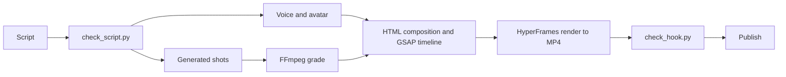

# AI video production

[](https://github.com/ahrimmedia-beep/ai-video-production/actions/workflows/ci.yml)

A pipeline that turns a script into a short vertical video for Instagram Reels and YouTube Shorts. Each video is an HTML page animated with one GSAP timeline and rendered to MP4 with HyperFrames. Python tools check the script before recording and the first seconds of the finished video before anyone sees it. The same system also makes Instagram carousels.

## The problem

Making many short videos by hand is slow, and the result changes from video to video. Each one needs a script, a voice track, shots, captions, motion graphics, sound and a color pass. The same mistakes come back: a silent first second, filler phrases in the script, captions that drift away from the voice.

## What I built

- A script checker. It splits a script file into one section per video and flags filler phrases, rhetorical questions, claims the brief does not allow, vague pronouns and a hook that opens with a number. It also estimates the voice length from the word count.
- A hook gate for rendered videos. FFmpeg finds silence in the first five seconds and Whisper gives the word timings. The video is rejected if the voice starts late or pauses for more than a second. After every command in the build session, a hook finds new MP4 files and runs the gate on them.
- Video compositions in HTML with one GSAP timeline per video. Four frame layouts (split screen, full graphic, full presenter, presenter in a circle) change smoothly from one to another. Two-tier captions sit on the word timings of the voice. The plate and the caption band change color with each background.
- One composition holds two endings, one for Instagram and one for YouTube Shorts. A script builds the YouTube version from it.
- An AI avatar track cut on the same segments as the voice, so the lips stay in sync after pauses are removed.
- A task runner for generative image and video models. It uploads reference images, creates a task, polls it and downloads the result, with retries.
- A color grade in FFmpeg with day and night presets, so shots from different models look like one film.
- The same steps and review gates for Instagram carousels.

## How it works



The script is checked first, while changes are cheap. The voice is recorded from the approved text, and Whisper gives a timing for every word. The composition places scenes, captions and accents on those timings. Generated shots get the same color grade before they go into the composition. HyperFrames opens the page in a headless browser, seeks the timeline frame by frame and encodes the result. The hook gate then checks the first five seconds of the MP4. A video that fails goes back for a fix.

## Selected code

This repository holds two real tools from the pipeline with their tests, and one composition reduced to an example. The scripts, storyboards, generation prompts, the other compositions and all media stay private.

| File | What it shows |
|---|---|
| `tools/check_script.py` | The script checker. Parsing, sentence splitting and every rule are pure functions. The rule lists live in one `Rules` object, so each project can set its own. |
| `tools/check_hook.py` | The hook gate. Pure functions read the FFmpeg log and the Whisper words and decide pass or fail. Thin wrappers call FFmpeg and mlx-whisper. |
| `tests/` | Tests for both tools. FFmpeg and Whisper are replaced with fakes, so the tests run on any machine. |
| `composition-example/` | One HyperFrames composition reduced to six scenes: frame layouts, theme changes, two-tier captions, a 3D card flip and a counter tied to timeline time. The presenter is a CSS placeholder and there is no audio. |

```bash
python3 -m venv .venv && source .venv/bin/activate
pip install -r requirements-dev.txt
pytest          # 59 tests, Python 3.10+
ruff check .
python -m tools.check_script tests/fixtures/sample_script.md   # one sample passes, one fails
```

`check_hook.py` needs FFmpeg and mlx-whisper (Apple silicon) to run on a real video. The composition needs Node.js for the HyperFrames CLI, see `composition-example/README.md`.

## Stack

HyperFrames, HTML, CSS, GSAP, Python, pytest, FFmpeg, Whisper (mlx-whisper), HeyGen avatars, generative image and video models, Claude Code.

## My role

I built the pipeline alone: the tools, the composition templates, the generation and editing workflow, and the videos made with it. The private repository holds ten video projects built this way.

## License

Published for viewing only. All rights reserved, see `LICENSE`.
